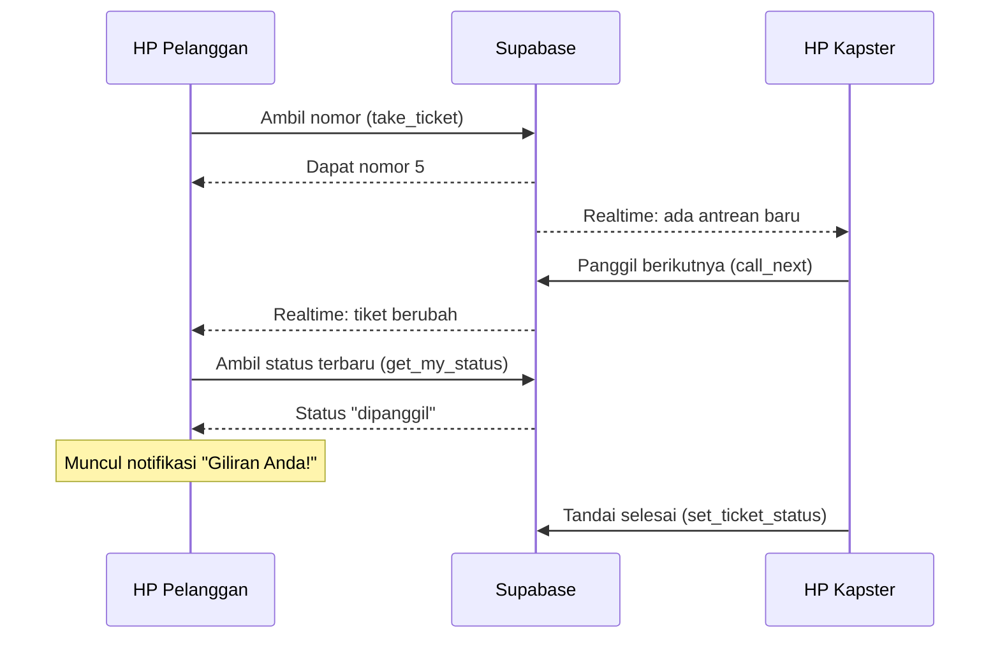
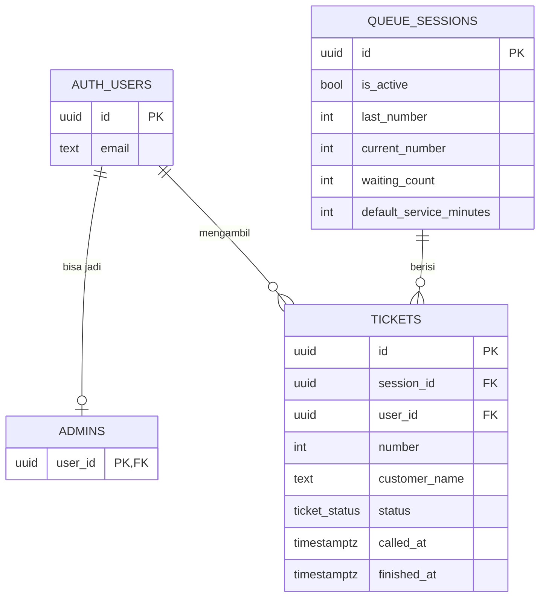

# Antre

Aplikasi antrean untuk Pangkas Rambut Pak Bambang. Pelanggan ambil nomor dari HP, lalu tinggal menunggu sampai dipanggil. Kapster memanggil nomor berikutnya dari HP-nya sendiri.

Dibuat dengan Flutter (Android) dan Supabase.

## Fitur

Pelanggan:

- Ambil nomor antrean cukup dengan mengisi nama, tanpa daftar akun.
- Lihat nomor yang sedang dipanggil, sisa orang di depan, dan perkiraan waktu tunggu.
- Dapat notifikasi saat nomornya dipanggil.
- Bisa membatalkan nomor sendiri.

Kapster:

- Login dengan email dan password.
- Lihat semua antrean hari ini.
- Panggil nomor berikutnya, tandai selesai atau dilewati.
- Reset antrean untuk memulai hari baru.

## Cara kerja



Penjelasan diagram di atas:

1. Pelanggan menekan "Ambil nomor". Aplikasi memanggil fungsi `take_ticket` di Supabase, lalu server memberi nomor urut. Nomor dihitung di server supaya dua orang tidak dapat nomor yang sama.
2. HP kapster langsung melihat antrean baru lewat Supabase Realtime, tanpa perlu refresh.
3. Kapster menekan "Panggil berikutnya". Status tiket berubah jadi `called`.
4. HP pelanggan menerima event realtime, mengambil status terbaru, lalu menampilkan "Giliran Anda!" dan memunculkan notifikasi.
5. Setelah selesai dicukur, kapster menandai tiket `done`.

Semua perubahan data lewat fungsi SQL (RPC). Aplikasi tidak pernah menulis langsung ke tabel, jadi aturan seperti "hanya admin yang boleh memanggil" dicek di server.

Status tiket:

| Status | Arti |
|---|---|
| `waiting` | Menunggu giliran |
| `called` | Sedang dipanggil |
| `done` | Selesai dicukur |
| `skipped` | Dilewati karena tidak ada di tempat |
| `cancelled` | Dibatalkan pelanggan |

## Struktur database



Penjelasan diagram di atas:

- `auth.users` adalah tabel user bawaan Supabase. Pelanggan masuk sebagai user anonim, sedangkan kapster pakai email dan password.
- `admins` berisi user yang boleh membuka halaman kapster. Satu user paling banyak satu baris.
- `queue_sessions` adalah satu sesi antrean, biasanya satu hari. Hanya boleh ada satu sesi aktif. Kolom seperti `current_number` dan `waiting_count` adalah ringkasan yang dibaca pelanggan.
- `tickets` adalah nomor antrean. Satu sesi punya banyak tiket, dan satu user hanya boleh punya satu tiket aktif per sesi.

## Struktur folder

```text
lib/
  core/          router, tema, koneksi Supabase, pesan error, notifikasi
  features/
    auth/        login kapster
    queue/       ambil nomor, status tiket, dashboard kapster
  shared/        widget yang dipakai bersama
supabase/
  migrations/    skema, RLS, dan fungsi RPC (dijalankan berurutan)
  tests/         test SQL
test/            unit test dan widget test
```

## Setup Supabase

1. Buat project Supabase. Di **Authentication → Sign In / Providers**, aktifkan **Anonymous Sign-Ins** dan **Email**.
2. Terapkan migrasi:

   ```bash
   supabase link --project-ref <project-ref>
   supabase db push --remote --dry-run   # cek dulu apa yang akan diterapkan
   supabase db push --remote
   ```

   Supabase CLI v3 defaultnya ke database lokal, jadi `--remote` wajib.
3. Buat user kapster di **Authentication → Users**, lalu jalankan di SQL editor:

   ```sql
   insert into admins (user_id) values ('<uuid-user-kapster>');
   ```

4. Salin `env.example.json` jadi `env.json`, lalu isi `SUPABASE_URL` dan `SUPABASE_ANON_KEY`. Pakai anon atau publishable key, jangan service role key. `BUSINESS_NAME` boleh diisi nama usaha untuk ditampilkan di beranda.

## Menjalankan

```bash
flutter pub get
flutter run --dart-define-from-file=env.json
```

Notifikasi "Giliran Anda!" adalah notifikasi lokal, jadi tidak perlu Firebase. Notifikasi ini hanya muncul selama aplikasi masih berjalan, baik terbuka maupun di background. Kalau aplikasi ditutup paksa, notifikasi tidak muncul.

## Test

```bash
flutter test                     # unit test dan widget test
supabase/tests/run_local.sh      # test SQL di Postgres lokal sementara
```

`run_local.sh` butuh Postgres terpasang (`brew install postgresql`). Script ini menerapkan semua migrasi ke database sementara, menjalankan `queue_test.sql`, lalu mencoba 30 pengambilan nomor sekaligus untuk memastikan tidak ada nomor ganda.

`queue_test.sql` juga bisa dijalankan di SQL editor Supabase. Semuanya di dalam transaksi yang di-rollback, jadi tidak meninggalkan data.

Untuk tes realtime, pakai dua HP atau dua emulator: satu sebagai pelanggan, satu sebagai kapster.
